# Orar Studio — planificator de orar universitar

Aplicație desktop în **C# (.NET 10, WPF, MVVM)** pentru elaborarea, verificarea, exportul și publicarea orarului
unei facultăți: **auditorii, discipline (obiecte), profesori, grupe și sarcina didactică**, editor manual flexibil
(drag & drop, dublu-clic, meniu contextual, Undo/Redo), export **PDF / Excel / CSV / iCalendar / JSON / site static**,
**server API REST** integrat pentru site-ul facultății și **panou informativ** pentru ecranele de pe hol.

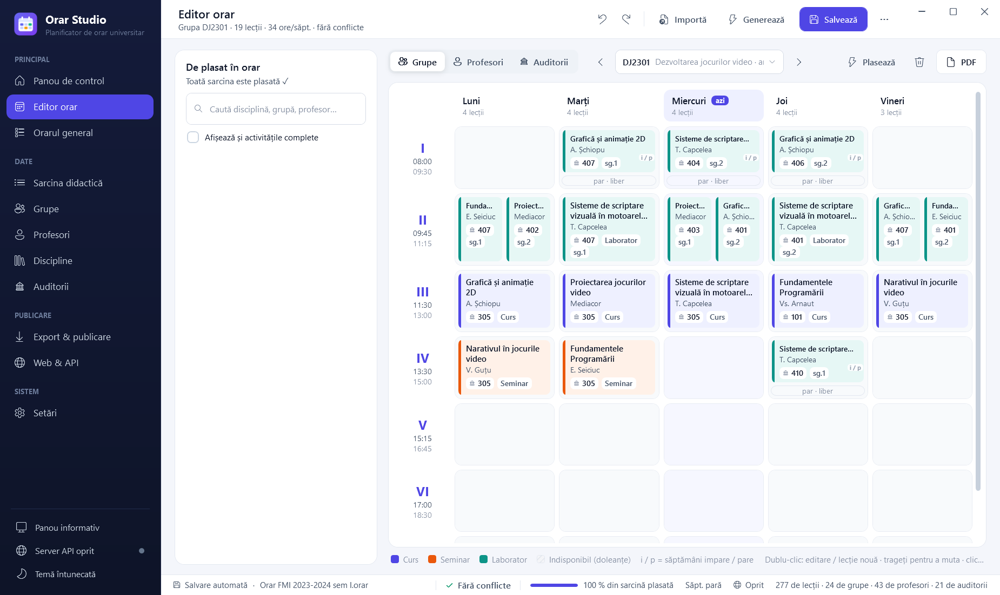

---

## Cerințele proiectului și cum sunt acoperite

| Cerință | Realizare |
|---|---|
| **Auditorii, obiecte, profesori** | Pagini dedicate (listă + formular): auditorii cu categorie, capacitate, destinație (curs / seminar / laborator), dotări; discipline cu abreviere, culoare, evaluare; profesori cu titlu, departament și **doleanțe** (intervale indisponibile); grupe cu subgrupe. |
| **Informații despre auditorii (unde se fac laboratoare, seminare/cursuri)** | Fiecare sală are bife „Cursuri / Seminare / Laboratoare”, capacitate, nr. de calculatoare, proiector, tablă. Verificarea conflictelor avertizează la sală nepotrivită sau prea mică; generatorul alege sala potrivită automat. |
| **Fișiere-exemplu** | Importul citește direct fișierele departamentelor: `DI_sem_1/3/5_Date pentru orar_2023-2024.xlsx` și `Date orar f-tea Mat&Inf … .docx` (plus CSV). Previzualizare editabilă, avertismente (grupe noi/greșeli de tipar), detectarea doleanțelor din text („Miercuri 13:00–15:00…” → miercuri, perechea IV). Datele demonstrative se generează din aceste fișiere. |
| **Redactor manual dar flexibil (datele se transferă în tabelul orar)** | Panoul „De plasat” cu activitățile din sarcina didactică → **trageți în grilă**. Celulele se colorează în timp real: verde = liber, galben = fără sală potrivită / doleanță, roșu = conflict. Lecțiile se mută (drag), se copiază (Ctrl + drag), se scot din orar (drag înapoi sau Del). |
| **Orar flexibil, cu posibilitatea schimbării** | Săptămâni **pare / impare** („fracții”), **subgrupe** în paralel, cursuri pe **serii** (mai multe grupe), perechi și zile configurabile, blocarea lecțiilor, **Undo / Redo** (Ctrl+Z / Ctrl+Y, până la 80 de pași), salvare automată, generare automată (completare sau regenerare). |
| **Export (PDF etc.)** | PDF (grupă / profesor / auditoriu / toate / orarul general A3, cu previzualizare), Excel (orar general + foaie pe grupă + liste), CSV, iCalendar (.ics) pentru telefon, JSON, site static. |
| **Publicare pe website prin API** | Server **ASP.NET Core** integrat: API REST JSON (CORS deschis), site public al orarului (responsiv, încorporabil prin iframe), PDF/iCal la cerere, documentație la `/docs`; plus publicare „push” (POST JSON + token) către site-ul facultății. |
| **Date pentru afișare pe panou** | Fereastra **Panou informativ** (ecran complet, F11): ceas, perechea curentă cu progres, „ACUM / URMEAZĂ” pe auditorii, grupe sau profesori, paginare automată; varianta web la `/board`, endpoint `/api/now`. |
| **Dublu-clic, evenimente** | Dublu-clic pe lecție → editare; pe celulă liberă → lecție nouă; pe activitate → plasare automată; pe rând (grupă/profesor/sală) → orarul lui. Drag & drop, meniuri contextuale, tastatură, tooltip-uri, notificări cu „Anulează”, timere (ceas, salvare automată), evenimente de date (`DataStore.Changed`). |

---

## Capturi de ecran

| | |
|---|---|
| 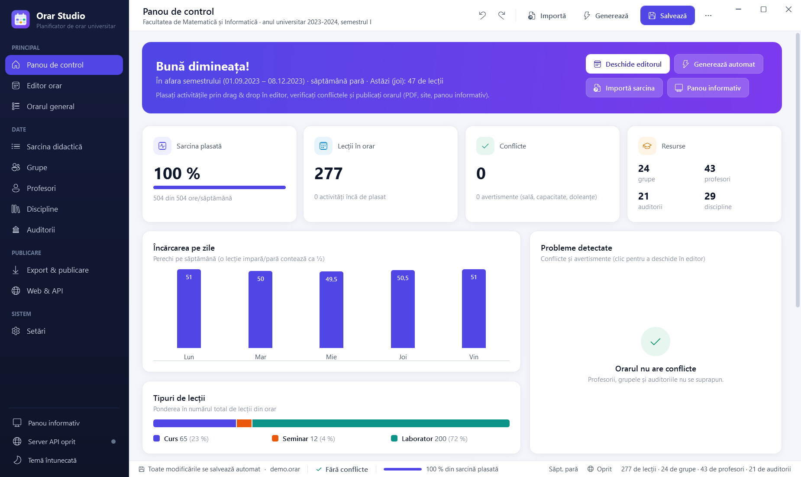 | 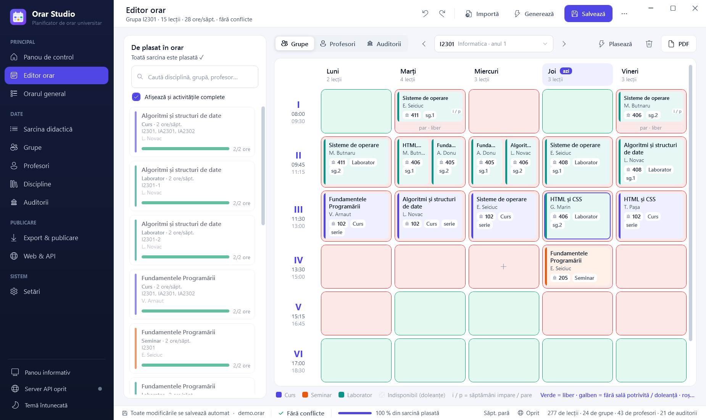 |
| Panoul de control | Drag & drop: verificarea intervalelor în timp real |
| 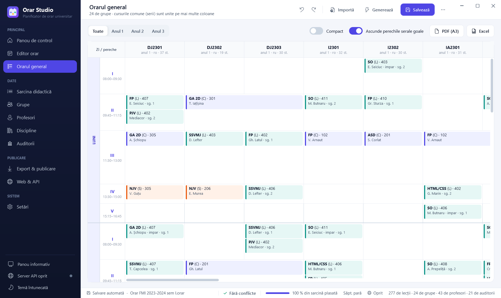 | 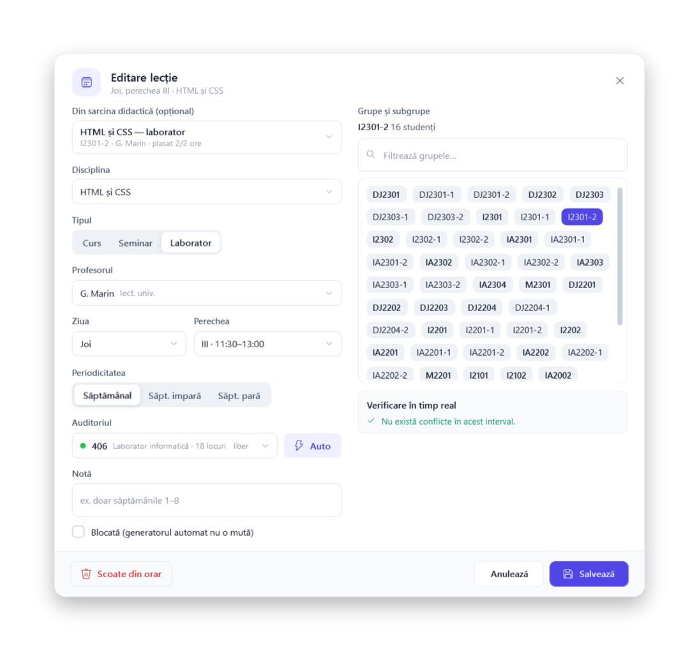 |
| Orarul general (seriile unite pe coloane) | Editarea unei lecții (dublu-clic) |
| 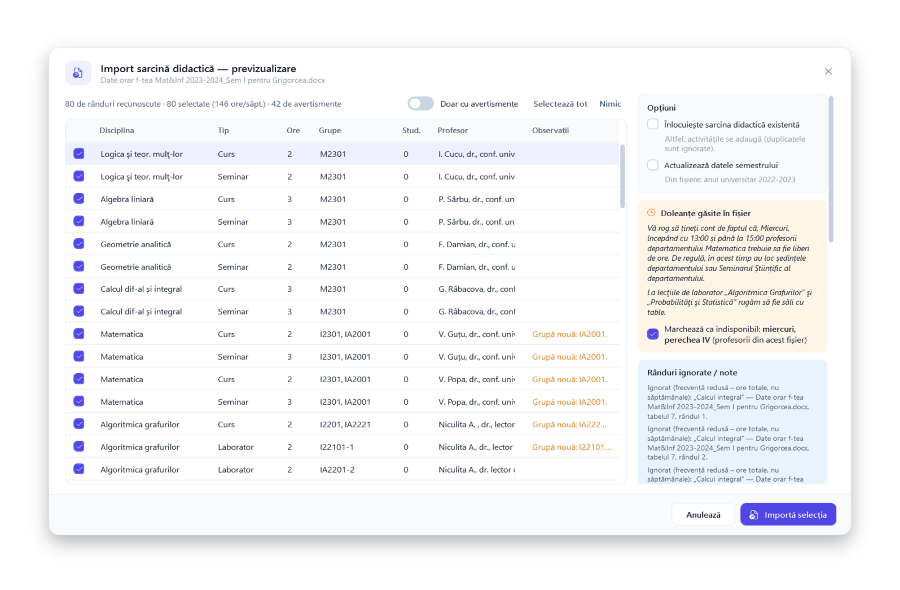 | 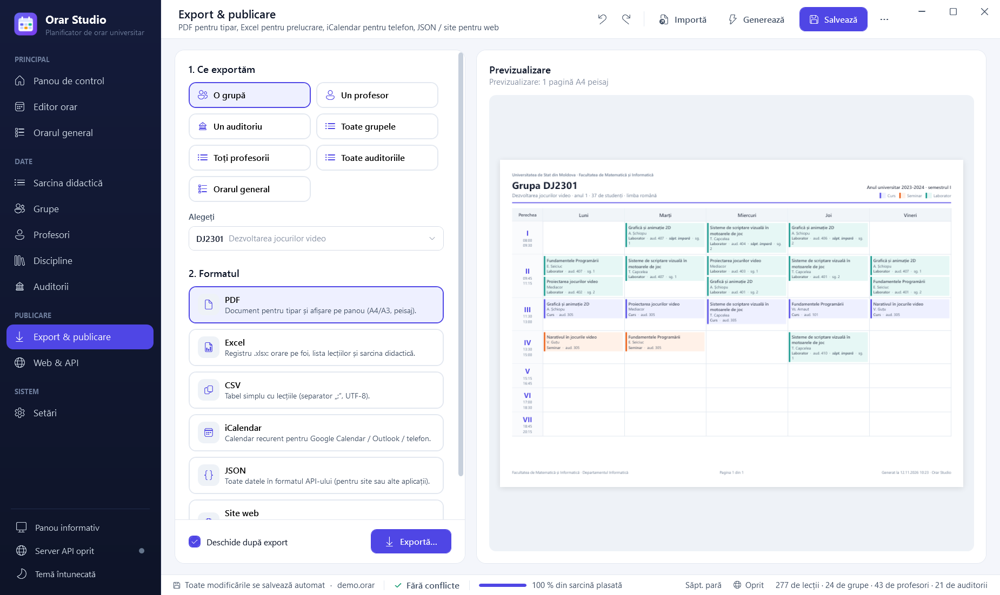 |
| Importul fișierelor departamentelor | Export cu previzualizare PDF |
| 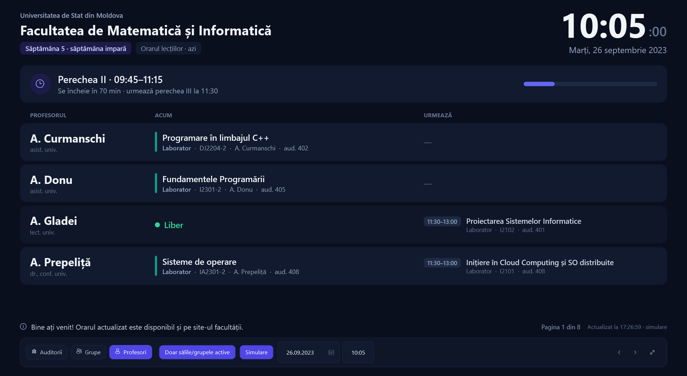 | 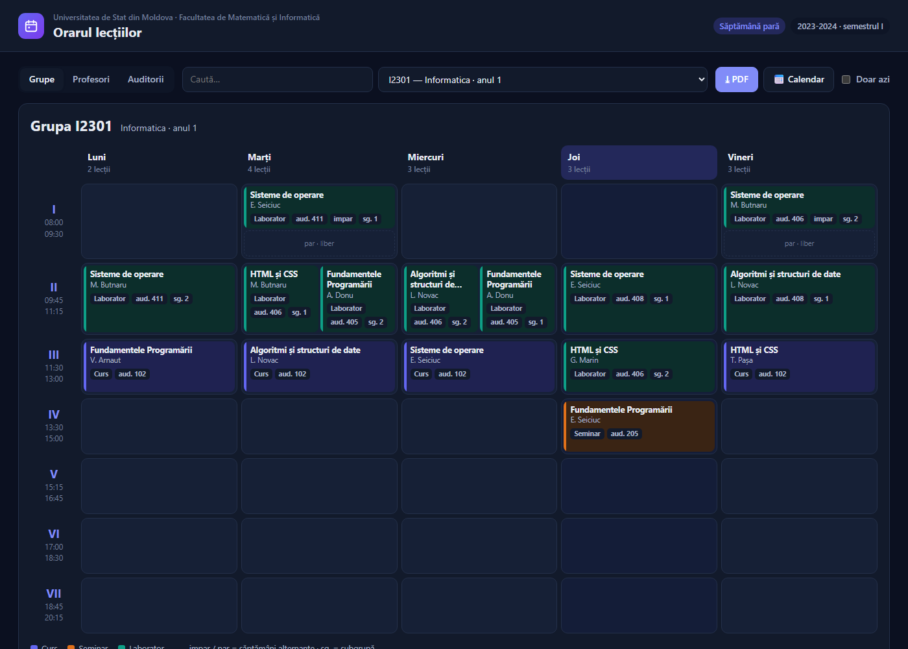 |
| Panoul informativ (ecran pe hol) | Site-ul public al orarului (prin API) |
| 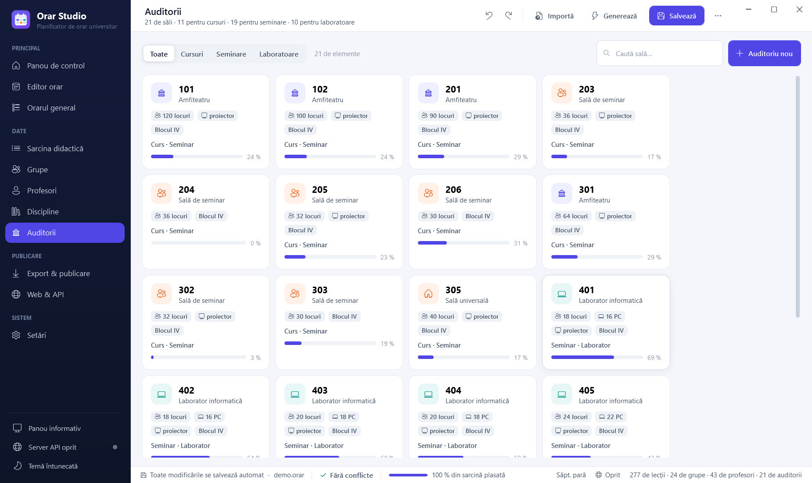 | 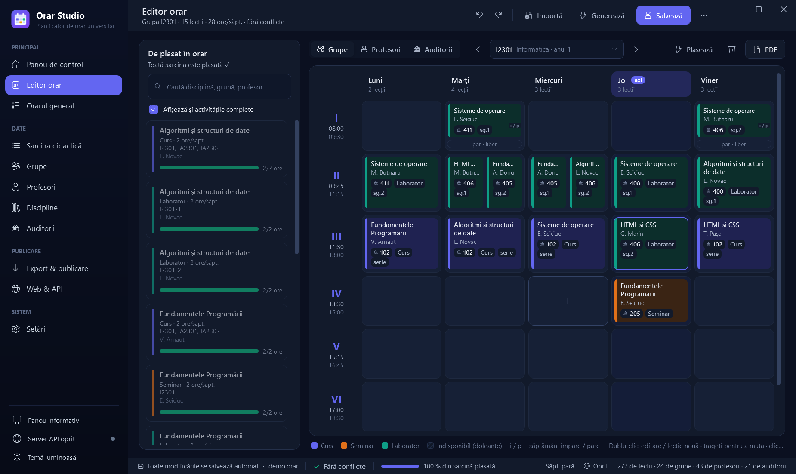 |
| Auditoriile și destinația lor | Tema întunecată |

---

## Pornire

### Varianta gata compilată
Descărcați **`OrarStudio-1.0.0-win-x64.zip`** din [Releases](https://github.com/ProiectDeSemestru/OrarStudio/releases/latest),
dezarhivați și porniți `OrarStudio.exe` — un singur fișier, **nu necesită instalarea .NET** (Windows 10/11, x64).
La prima pornire se încarcă datele demonstrative (sarcina didactică din fișierele-exemplu + un orar generat automat).

### Din codul sursă
Necesar: **.NET SDK 10** (sau Visual Studio 2026 cu componenta *„.NET desktop development”*).

```powershell
dotnet build OrarStudio.slnx
dotnet run --project src\OrarStudio
dotnet test                                   # 32 de teste unitare
dotnet publish src\OrarStudio -c Release -r win-x64 --self-contained -p:PublishSingleFile=true -p:IncludeNativeLibrariesForSelfExtract=true -o dist
```

Opțiuni de linie de comandă: `OrarStudio.exe <fișier.orar>` deschide un proiect; `--demo` reîncarcă datele demonstrative;
`--snapshot <dosar>` (diagnostic) salvează capturi ale tuturor ecranelor și testează API-ul.

---

## Utilizare rapidă

1. **Importă** sarcina didactică (`Ctrl+I`) — fișierele .xlsx/.docx ale departamentelor; verificați previzualizarea.
2. Completați **auditoriile** (destinație, capacitate) și **doleanțele** profesorilor.
3. **Generează** automat (`Ctrl+G`) sau plasați manual în **Editor orar**: trageți activitățile din stânga în grilă.
4. Rezolvați eventualele conflicte (bara de stare → „lecții în conflict”, sau „Probleme” în panoul de control).
5. **Exportă** (PDF/Excel/…) sau porniți **Web & API** pentru site și **Panoul informativ** (F11) pentru ecrane.

### Interacțiuni în editor

| Acțiune | Efect |
|---|---|
| Trageți o activitate din „De plasat” în grilă | Creează lecția (sala potrivită se alege automat; 1 oră/săpt. → săptămâna impară/pară) |
| Trageți o lecție | Mutare (dacă sala e ocupată, se propune alta) · **Ctrl** = copiere · în panoul din stânga = scoatere din orar |
| Dublu-clic pe lecție / pe celulă liberă | Editare / lecție nouă |
| Dublu-clic pe o activitate | Plasare automată |
| Clic dreapta pe lecție | Periodicitate, schimbare auditoriu, blocare, deschiderea orarului grupei/profesorului/sălii, ștergere |
| Clic dreapta pe celulă (perspectiva Profesor) | Marchează intervalul ca indisponibil (doleanță) |
| `Del` · `Enter` · `Esc` · `Ctrl+L` · `Alt+←↑→↓` · `PgUp/PgDn` | Ștergere · editare · deselectare · blocare · mutare cu tastatura · entitatea precedentă/următoare |

Comenzi globale: `Ctrl+Z` / `Ctrl+Y` (anulare/refacere), `Ctrl+S` (salvare), `Ctrl+Shift+S` (salvare ca), `Ctrl+O` (deschidere),
`Ctrl+I` (import), `Ctrl+G` (generare), `Ctrl+E` (export), `Ctrl+1…4` (navigare), `F11` (panou informativ).

---

## API REST (Web & API → „Pornește serverul”, implicit `http://localhost:5080`)

| Endpoint | Descriere |
|---|---|
| `GET /` · `/board` · `/docs` | Site-ul public al orarului · panoul informativ web · documentația API |
| `GET /api/info` | Instituția, semestrul, perechile, săptămâna curentă (pară/impară) |
| `GET /api/bundle` | Toate datele (pentru site-uri) |
| `GET /api/groups` · `/api/teachers` · `/api/rooms` · `/api/subjects` | Liste |
| `GET /api/lessons?group=&teacher=&room=&day=&type=&week=` | Lecțiile filtrate |
| `GET /api/schedule/group/{cod}` · `/teacher/{nume}` · `/room/{nume}` | Orarul săptămânal |
| `GET /api/now?mode=rooms\|groups\|teachers&at=` | „Acum / urmează” pentru panou (`at` = moment simulat) |
| `GET /api/pdf/group/{cod}` · `/api/pdf/overview` · `/api/ics/group/{cod}` | PDF / iCalendar generate la cerere |

Încorporare pe un site existent: `<iframe src="http://SERVER:5080/?group=I2301&embed=1" width="100%" height="720"></iframe>`.

---

## Arhitectură

```
src/OrarStudio
├── Models/        entități (Room, Subject, Teacher, StudentGroup, TeachingActivity, Lesson…), Audience (grupe/subgrupe), calendarul semestrului
├── Services/      DataStore (sursa unică de date, Undo/Redo, salvare automată), ConflictService, AutoScheduler, TimetableBuilder, SampleData
├── Import/        LoadImporter — parsarea fișierelor .xlsx (ClosedXML), .docx (OpenXML), .csv
├── Export/        PDF (QuestPDF), Excel (ClosedXML), CSV, iCalendar
├── Api/           ApiServer (ASP.NET Core Minimal API), BoardLogic, DTO-uri, publicare webhook, site static
├── ViewModels/    MVVM (CommunityToolkit.Mvvm): câte un ViewModel pe pagină + dialoguri
├── Views/         XAML: fereastra principală, pagini, dialoguri, panoul informativ
├── Themes/        sistemul de design (temă luminoasă/întunecată, stiluri pentru toate controalele)
└── Web/           site-ul public, panoul web și documentația API (resurse încorporate)
tests/OrarStudio.Tests   teste xUnit: parsare, conflicte, săptămâni pare/impare, generare, export
```

- **Date:** proiectul se salvează ca JSON (`*.orar`), automat, în `%LOCALAPPDATA%\OrarStudio\orar-curent.orar` (sau în fișierul ales cu „Salvează ca”).
- **Conflicte:** profesor / grupă / auditoriu ocupat (ținând cont de săptămâni pare-impare și de subgrupe), sală nepotrivită sau prea mică, doleanțe.
- **Generator automat:** euristic — cursuri pe serii, apoi laboratoare, apoi seminare; alege intervalul cu „cost” minim (fără ferestre, zile echilibrate, perechi nu prea târzii). Pe datele-exemplu plasează toate cele 277 de lecții fără conflicte în ~0,2 s.

## Tehnologii
C# 14 · .NET 10 · WPF · CommunityToolkit.Mvvm · ASP.NET Core (Kestrel) · QuestPDF (licență Community) · ClosedXML / DocumentFormat.OpenXml · xUnit.
